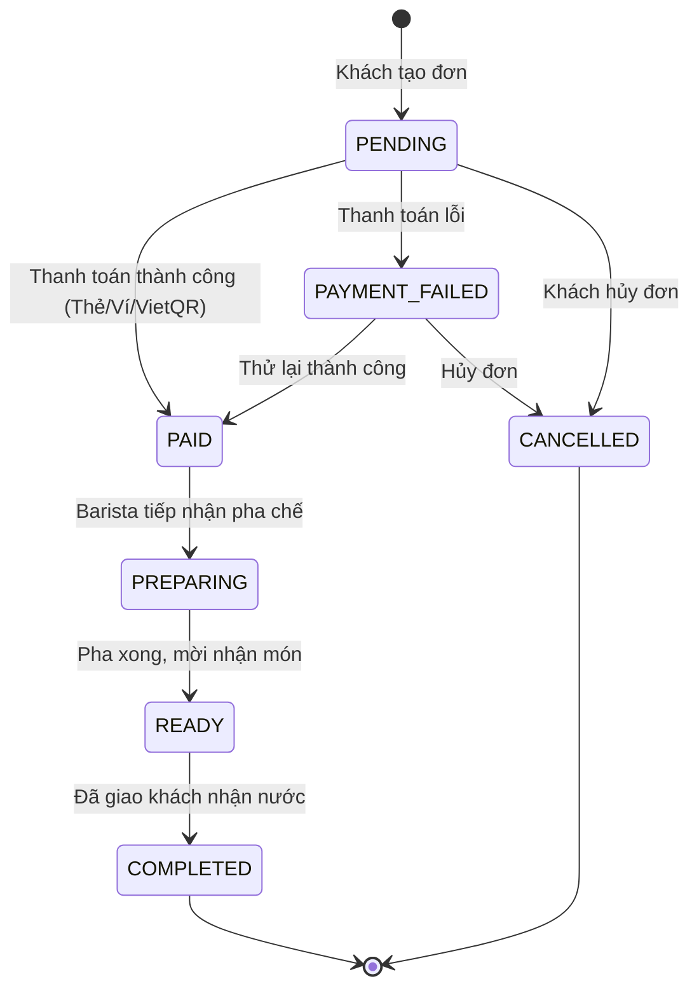

# ☕ BrewLite — Hệ Thống Đặt Hàng & Thanh Toán Cà Phê Không Dùng Tiền Mặt
## (Cashless Coffee Ordering & Kitchen Management Platform — VER 1.0)

> **Cơ sở đào tạo**: TRƯỜNG ĐẠI HỌC SÀI GÒN — KHOA CÔNG NGHỆ THÔNG TIN  
> **Môn học**: Công Nghệ Phần Mềm (Software Engineering) — Học kỳ I, Năm học 2026–2027  
> **Kiến trúc hệ thống**: Monorepo NestJS 10 (Backend REST API) + Next.js 14 App Router (Frontend Web App) + PostgreSQL 16 + Prisma ORM 5.x + Docker Compose  
> **Mô hình phát triển**: Agile Scrum kết hợp Order State Machine & Optimistic Concurrency Control (OCC)  
> **Repository GitHub**: [https://github.com/hanhdevsgu/BrewLite-Assignment2](https://github.com/hanhdevsgu/BrewLite-Assignment2)  
> **Nhánh tích hợp chính**: `develop` | **Nhánh chức năng**: 7 Feature Branches (`feat/p1` đến `feature/p7`)  

---

## 🎯 1. TỔNG QUAN DỰ ÁN & PRODUCT VISION (MỤC 3 ĐỀ BÀI)

### 1.1 Product Vision
> *"BrewLite giúp khách hàng đặt và thanh toán đồ uống không dùng tiền mặt chỉ trong vài chạm, giảm thời gian xếp hàng và nhận đơn nhanh tại quầy."*

### 1.2 Các Bên Liên Quan (Stakeholders)
- **Khách hàng**: Đặt đồ uống, chọn size/topping, thanh toán không tiền mặt (VietQR/MBBank Simulator) và theo dõi lịch sử đơn.
- **Nhân viên quầy / Barista**: Tiếp nhận đơn và cập nhật trạng thái pha chế thời gian thực trên Bảng Kanban (`/staff`).
- **Quản lý cửa hàng / Product Owner**: Xác định yêu cầu, ưu tiên Product Backlog và nghiệm thu Increment sau mỗi Sprint.
- **Nhóm phát triển (Development Team)**: 7 thành viên phân tích, thiết kế, lập trình, kiểm thử và bàn giao hệ thống.
- **Đơn vị thanh toán**: Cổng thanh toán mô phỏng (Mock Payment Gateway & MBBank Webhook).

---

## 🔄 2. QUY TRÌNH AGILE SCRUM & KẾ HOẠCH 3 SPRINT (MỤC 2 ĐỀ BÀI)

### 2.1 Thành Viên Nhóm Phát Triển (Development Team)
Nhóm gồm 7 thành viên đảm nhận 7 gói công việc độc lập trên 7 nhánh tính năng riêng:
1. **Võ Đức Hoàng Vinh** (`V9vinh`): Layout nền tảng, Catalog Menu thực đơn số, tìm kiếm debounce, badge tạm hết hàng (`feat/p1-menu-page`).
2. **Hồ Hoàng Anh** (`anhho7303-source`): Modal tùy chọn nhanh, chi tiết món `/products/:id`, Size S/M/L, đường đá topping, đánh giá (`feat/p2-product-details`).
3. **Dương Thành Phát** (`phatthanh-kiko`): Quản lý giỏ hàng Zustand persist, gộp biến thể, voucher thông minh, điểm loyalty (`feat/p3-cart-store`).
4. **Quách Thanh Phú** (`quachthanhphuu-maker`): Xác thực tài khoản, màn hình Checkout, mã VietQR Canvas nội bộ, mô phỏng MBBank (`feat/p4-checkout-history`).
5. **Đặng Lương Thế Anh** (`dangluongtheanh-max`): CSDL PostgreSQL, Prisma ORM, API `GET /products` đối chiếu định lượng nguyên liệu (`feat/p5-api-products`).
6. **Nguyễn Hoàng Anh** (`hanhdevsgu`): Quản lý kho nguyên liệu, API `POST /orders`, Auth JWT/Bcrypt, Mock Payment Gateway (`feat/p6-payment-ingredients-orders`).
7. **Hoàng Trần Gia Phước** (`gphuoc-216`): Order State Machine, Idempotency-Key, Optimistic Locking (OCC), Docker Compose (`feature/p7-backend`).

### 2.2 Kế Hoạch Triển Khai Theo Sprint Cho BrewLite
> **Ánh xạ với Assignment 2 (2 Sprint chính):** Đề bài chia giai đoạn lập trình thành **Sprint 1 (Task 4 — Nền tảng, Tài liệu, MVP Menu & CI)** và **Sprint 2 (Task 5 — Checkout, Thanh toán Idempotent, OCC, Kanban, Admin & CD/Delivery)**. Trong quá trình làm việc 7 người, nhóm chia nhỏ thành 3 đợt ngắn dưới đây để tích hợp liên tục (`Đợt 1` = Task 4 / Sprint 1; `Đợt 2 + Đợt 3` = Task 5 / Sprint 2):

| Đợt (Nhóm Assignment 2) | Thời Lượng | Mục Tiêu Sprint (Sprint Goal) | Nhiệm Vụ Hoàn Thành | Sản Phẩm Tăng Dần (Increment) |
|:---:|:---:|:---|:---|:---|
| **Đợt 1 (Sprint 1 — Task 4)** | 14/10 – 20/10 | Nền tảng, Tài liệu, MVP Menu & CI | Task 1, Task 2, Task 3, Task 4 | Khởi tạo Monorepo, CSDL PostgreSQL, API Products + unit/IT test tối thiểu, Giao diện Menu & Modal chi tiết món, GitHub Actions CI. |
| **Đợt 2 (Sprint 2a — Task 5)** | 21/10 – 27/10 | Giỏ hàng, Đặt đơn & Đăng nhập | Task 5, Task 6, Task 7 | Giỏ hàng Zustand persist, Voucher, Điểm loyalty, API `POST /api/orders`, Auth JWT / Bcrypt. |
| **Đợt 3 (Sprint 2b — Task 5)** | 28/10 – 02/11 | Thanh toán, Nghiệp vụ nâng cao & CD | Task 8, Task 9, Task 10 | Thanh toán VietQR / MBBank, Lịch sử đơn, Order State Machine, OCC chống oversell kho, Docker Compose, 12 suites (119 Jest unit tests), 9 Supertest HTTP integration tests & CD. |

### 2.3 Quy Tắc Git Flow & Lịch Sử Merge Code (Git Branching Strategy)
```
feat/p1-menu-page ──────────► (PR #3) ──┐
feat/p2-product-details ────► (PR #4) ──┤
feat/p3-cart-store ─────────► (PR #2) ──┤
feat/p4-checkout-history ───► (PR) ─────┼──► develop (Nhánh tích hợp chính)
feat/p5-api-products ───────► (PR #1) ──┤
feat/p6-payment-ingredients ► (PR) ─────┤
feature/p7-backend ─────────► (PR) ─────┘
```
1. **Phân nhánh độc lập**: Mỗi thành viên code trên 1 nhánh tính năng riêng (`feat/p1` đến `feature/p7`).
2. **Quy trình tích hợp**: Các tính năng được phát triển trên từng nhánh riêng và tích hợp vào nhánh chính `develop` qua Pull Request sau khi hoàn tất kiểm thử và review.

---

## 📋 3. PRODUCT BACKLOG: BẢNG 10 TASK CHUẨN ĐỀ BÀI (10 ĐIỂM)

Bảng đối chiếu 1-1 giữa 10 Task trong đề bài PDF với phân công 7 thành viên và 7 feature branch:

| Task | Tên Nhiệm Vụ (PDF) | Điểm | Thành Viên Phụ Trách | Nhánh Git | Tiêu Chí Chấp Nhận Chính (Acceptance Criteria) |
|:---:|:---|:---:|:---|:---:|:---|
| **Task 1** | Khởi tạo dự án & cấu trúc | 1đ | Võ Đức Hoàng Vinh (FE)<br>Đặng Lương Thế Anh (BE) | `feat/p1-menu-page`<br>`feat/p5-api-products` | Monorepo Next.js 14 + NestJS 10, PostgreSQL Prisma, Docker Compose, .env.example, README, build 0 lỗi. |
| **Task 2** | API danh sách sản phẩm | 1đ | Đặng Lương Thế Anh | `feat/p5-api-products` | `GET /products` trả về JSON menu (id, tên, giá, ảnh); tự động tính tồn kho nguyên liệu ra cờ `isOutOfStock`. |
| **Task 3** | Trang Menu (Frontend) | 1đ | Võ Đức Hoàng Vinh | `feat/p1-menu-page` | Next.js gọi `/products`, render lưới sản phẩm responsive, search debounce, loading/empty state, badge `⛔ Tạm hết hàng`. |
| **Task 4** | Chi tiết & tùy chọn sản phẩm | 1đ | Hồ Hoàng Anh | `feat/p2-product-details` | Modal Quick Select & `/products/:id`, chọn Size S/M/L (tự vô hiệu hóa size hết), đường/đá/topping có ảnh, gửi đánh giá sao. |
| **Task 5** | Giỏ hàng (Cart Store) | 1đ | Dương Thành Phát | `feat/p3-cart-store` | Zustand Store persist, gộp món cùng biến thể, trang `/cart`, voucher thông minh, tích lũy & dùng điểm (1đ = 100đ). |
| **Task 6** | API tạo đơn hàng | 1đ | Nguyễn Hoàng Anh | `feat/p6-payment-ingredients-orders` | `POST /api/orders` nhận giỏ hàng, validate `class-validator`, áp dụng voucher/tạm giữ điểm loyalty, lưu đơn `PENDING` (trừ kho OCC thực hiện khi thanh toán `POST /api/payments`). |
| **Task 7** | Đăng ký / Đăng nhập (JWT) | 1đ | Quách Thanh Phú (FE)<br>Nguyễn Hoàng Anh (BE) | `feat/p4-checkout-history`<br>`feat/p6-payment-ingredients-orders` | `POST /api/auth/register`, `/api/auth/login`, `/api/auth/refresh`, băm Bcrypt 10 rounds, Access (15m)/Refresh (7d) Token, `JwtAuthGuard` bảo vệ route. |
| **Task 8** | Thanh toán không tiền mặt | 1đ | Quách Thanh Phú (FE)<br>Nguyễn Hoàng Anh (BE) | `feat/p4-checkout-history`<br>`feat/p6-payment-ingredients-orders` | Mock Payment (Ví/Thẻ/đơn 0đ qua `WALLET`), `POST /api/payments`, chuyển `PAID` / `PAYMENT_FAILED`, vẽ mã VietQR Canvas nội bộ, MBBank simulator. |
| **Task 9** | Xác nhận, lịch sử & bàn giao | 1đ | Quách Thanh Phú (FE)<br>Hoàng Trần Gia Phước (BE) | `feat/p4-checkout-history`<br>`feature/p7-backend` | Màn hình xác nhận đơn, `GET /api/orders/me` (lịch sử đơn); Docker Compose 3 container hoàn chỉnh; demo end-to-end. |
| **Task 10** | Nghiệp vụ backend chuyên sâu | 1đ | Nguyễn Hoàng Anh (Kho & Voucher)<br>Hoàng Trần Gia Phước (State & OCC) | `feat/p6-payment-ingredients-orders`<br>`feature/p7-backend` | Order State Machine chống gian lận, Idempotency-Key chống trừ trùng, OCC khóa lạc quan tồn kho, 12 suites (119 unit tests Jest) + 9 integration tests Supertest pass. |

---

## ⚙️ 4. TASK 10: NGHIỆP VỤ BACKEND CHUYÊN SÂU & STATE MACHINE (MỤC 9 ĐỀ BÀI)

### 4.1 Sơ Đồ Máy Trạng Thái Đơn Hàng (Order State Machine)

- **Hàm chặn chuyển trạng thái sai**: `assertTransition(fromStatus, toStatus)` sẽ ném `ConflictException (HTTP 409)` nếu cố tình nhảy cóc trạng thái (VD: `PENDING` nhảy thẳng lên `COMPLETED` sẽ bị chặn ngay lập tức).
- **Trạng thái kết thúc**: `COMPLETED` và `CANCELLED` là trạng thái đóng, không được phép chuyển tiếp thêm.

### 4.2 Bốn Nghiệp Vụ Backend Cốt Lõi
1. **Order State Machine**: Quản lý vòng đời đơn hàng nghiêm ngặt, ghi audit log `order_status_histories`.
2. **Thanh toán Idempotent**: Sử dụng `Idempotency-Key` duy nhất trên mỗi giao dịch. Nếu gửi lặp lại cùng một request, hệ thống trả về kết quả đã cache mà không trừ tiền hay tạo đơn lần 2.
3. **Kiểm soát tồn kho khi đặt đồng thời (OCC)**: Kết hợp PostgreSQL Transaction + Optimistic Locking (cột `version` trên `Ingredient`). Tự động retry tối đa 3 lần, giải quyết triệt để bài toán overselling khi 10 khách cùng bấm đặt 1 món.
4. **Khuyến mãi & Điểm thưởng Loyalty**: Áp dụng mã voucher hợp lệ và tự động tích lũy điểm thưởng cho khách hàng sau khi đơn chuyển sang `PAID` (1 điểm = 100đ).

---

## 🚀 5. HƯỚNG DẪN CÀI ĐẶT & KHỞI CHẠY HỆ THỐNG (CHI TIẾT TỪ A ĐẾN Z)

### 5.1 Yêu Cầu Tiên Quyết (Prerequisites)
- **Node.js**: Phiên bản `18.x`, `20.x LTS` hoặc `22.x` (Khuyến nghị `Node.js 20.x`). Kiểm tra: `node -v`.
- **NPM**: Phiên bản `9.x` hoặc `10.x`. Kiểm tra: `npm -v`.
- **Git**: Đã cài đặt trên máy. Kiểm tra: `git --version`.
- **Docker Desktop**: Chạy dịch vụ PostgreSQL cục bộ. Kiểm tra: `docker --version`.

---

### 5.2 Khởi Tạo Dự Án Lần Đầu (Zero-Config — Chạy 1 Lệnh Duy Nhất)

Khi vừa clone dự án về máy mới, mở terminal tại thư mục gốc `Assigment2` và chạy:

```powershell
npm run setup
```

> ⚡ **Lệnh này tự động 100%:**
> 1. Tự sinh file cấu hình `.env` cho Backend và `.env.local` cho Frontend.
> 2. Tự cài đặt đầy đủ thư viện `node_modules` cho cả Root, Backend và Frontend.
> 3. Tự khởi chạy container PostgreSQL trên Docker (Port 5432).
> 4. Tự sinh Prisma Client và đồng bộ cấu trúc cơ sở dữ liệu (`prisma db push`).
> 5. Tự nạp dữ liệu mẫu ban đầu (`seed` sẵn tài khoản Admin, Barista, Khách hàng, 12 món đồ uống / 108 biến thể (3 size S/M/L × 3 cấu hình topping), 10 nguyên liệu, voucher).

---

### 5.3 Quy Trình Khởi Chạy Hàng Ngày (Chuẩn 4 Bước — Khuyên Dùng Cho Dev & Demo)

Khi mở máy lên để làm việc hoặc chuẩn bị thuyết trình đồ án, bạn chạy lần lượt theo **đúng thứ tự 4 bước** sau:

#### 🐳 Bước 1: Khởi động Database PostgreSQL (Chạy ngầm trên Docker)
Mở Terminal tại thư mục gốc dự án và gõ:
```powershell
npm run docker:up
```
> *(Lệnh này sẽ bật container `brewlite_postgres` trên cổng `5432` trong 2 giây. Chỉ cần chạy 1 lần duy nhất khi mới mở máy).*

---

#### 🪟 Bước 2: Khởi động Backend API (NestJS — Cổng 3001)
Mở một cửa sổ Terminal mới (Terminal 1) tại thư mục gốc:
```powershell
npm run dev:backend
```
* 🟢 **Backend URL**: [http://localhost:3001](http://localhost:3001)
* 📑 **Tài liệu Swagger OpenAPI**: [http://localhost:3001/api/docs](http://localhost:3001/api/docs)
*(Đợi 5–10 giây khi thấy dòng chữ xanh: `Nest application successfully started` là Backend đã sẵn sàng).*

---

#### 🪟 Bước 3: Khởi động Frontend Web App (Next.js 14 — Cổng 3000)
Mở thêm một cửa sổ Terminal mới (Terminal 2) tại thư mục gốc:
```powershell
npm run dev:frontend
```
* ☕ **Trang Đặt Món Khách Hàng**: [http://localhost:3000](http://localhost:3000)
* 👨‍🍳 **Bảng Kanban Quầy Barista**: [http://localhost:3000/staff](http://localhost:3000/staff)
* 👑 **Dashboard Quản Trị Viên (Admin)**: [http://localhost:3000/admin](http://localhost:3000/admin)
*(Đợi hiển thị: `Ready in ... on http://localhost:3000` là vào web được ngay).*

---

#### 🗄️ Bước 4 (Tùy chọn): Mở Trình Quản Trị CSDL Trực Quan (Prisma Studio — Cổng 5555)
Nếu muốn mở giao diện web xem toàn bộ bảng dữ liệu, đơn hàng, khách hàng, tồn kho như Excel:
```powershell
npm run prisma:studio
```
* 🗄️ **Giao diện CSDL trực quan**: [http://localhost:5555](http://localhost:5555)
* Nhấp đúp chuột vào bất kỳ ô nào để sửa dữ liệu trực tiếp và bấm **"Save changes"**.

---

#### 🧹 Lệnh Phụ Trợ Đặc Biệt: Reset Database Trắng Tinh Cho Buổi Demo
Bất cứ khi nào bạn test thử đặt hàng xong và muốn **xóa trắng toàn bộ đơn cũ, khôi phục lại 100% tồn kho nguyên liệu**:
```powershell
npm run clean:db
```
*(Chỉ mất 1 giây để đưa toàn bộ hệ thống về trạng thái sạch sẽ ban đầu).*

---

### 5.4 Công Cụ Chỉnh Nhanh Tồn Kho Để Kiểm Thử (Không Cần Nhớ UUID)

Để kiểm tra các kịch bản **Hết hàng** hoặc **2 khách tranh mua 1 ly cuối cùng**, bạn có 3 cách thực hiện cực nhanh:

#### ⚡ Cách A: Gõ lệnh terminal theo tên (Nhanh nhất — 1 giây)
Tại thư mục gốc, sử dụng script `npm run stock` kèm tên món/nguyên liệu và số lượng:
```powershell
# 1. Đặt cà phê hạt Robusta còn đúng 10g (đủ cho 1 ly) để test 2 người tranh mua cùng lúc:
npm run stock -- "Robusta" 10

# 2. Đặt chanh tươi về 0 để test món Chanh Tuyết tự động báo "Tạm hết hàng":
npm run stock -- "Chanh" 0

# 3. Xem bảng tổng hợp tồn kho hiện tại của toàn bộ nguyên liệu:
npm run stock
```

#### 🖥️ Cách B: Bấm nút "Sửa tồn" trên Web Admin
1. Đăng nhập tài khoản Admin tại [http://localhost:3000/admin](http://localhost:3000/admin).
2. Vào tab **Kho nguyên liệu**.
3. Mỗi nguyên liệu đều có nút **`[✏️ Sửa tồn]`** trực tiếp. Bấm vào, gõ số lượng (vd: `10` hoặc `0`) rồi bấm **Lưu số lượng**.

#### 🌐 Cách C: Nhập trực tiếp Tên nguyên liệu trên Swagger
Tại endpoint `PATCH /api/admin/ingredients/{id}` trên Swagger ([http://localhost:3001/api/docs](http://localhost:3001/api/docs)):
- Ô `{id}`: Nhập thẳng tên như `Chanh`, `Robusta`, `Trứng`, `Sữa`... (Backend tự nhận diện mà không cần UUID).
- Body: `{"stockQuantity": 10}`.

---

### 5.5 Khởi Chạy Toàn Bộ Bằng Docker Compose (Chạy Khép Kín)

Nếu muốn đóng gói toàn bộ cả 3 dịch vụ (PostgreSQL + Backend + Frontend) chạy đồng thời trong Docker:
```powershell
npm run docker:all
# Hoặc:
docker compose up -d --build
```

#### Tắt các container:
```powershell
npm run docker:down
```

---

### 5.6 Demo Quét Mã QR Bằng Điện Thoại Thật (Mobile QR Payment)
```powershell
npm run phone
# Hoặc:
node scripts/tunnel.js
```
> Terminal in **Mã QR to rõ ngay trên console** và một đường link HTTPS công khai. Dùng camera điện thoại quét để mở ứng dụng MBBank Simulator!

---

### 5.7 Chạy Kiểm Thử Tự Động (Automated Testing)

#### 1. Chạy Unit Tests & HTTP Integration Tests Backend (`12` suites / `119` unit tests + `9` integration tests Jest pass):
```powershell
npm run test
# Hoặc:
npm --prefix backend test
npm --prefix backend run test:e2e
```
*Kiểm thử toàn diện: Products Menu/Toppings & `isOutOfStock`, Auth JWT (`15m`/`7d`), State Machine, Idempotency-Key, Loyalty, Optimistic Locking tồn kho, Review `KiemTraDaMua` (`COMPLETED`), ValidationPipe & RBAC.*

#### 2. Kiểm thử xung đột đồng thời (Race Condition Concurrency Test):
```powershell
npm run test:race
# Hoặc:
node scripts/test-race-condition.js
```
*Mô phỏng 10-20 request tranh mua cùng lúc, chứng minh OCC khóa lạc quan không bao giờ làm âm kho.*

---

### 5.8 Xử Lý Các Sự Cố Thường Gặp (Troubleshooting / FAQ)

#### ❓ Lỗi 1: `Error: listen EADDRINUSE: address already in use :::3000` (hoặc `:::3001`)
* **Nguyên nhân**: Cổng 3000 hoặc 3001 đang bị một tiến trình Node.js trước đó chiếm dụng.
* **Cách khắc phục nhanh trên PowerShell**:
  ```powershell
  # Tìm và tắt tiến trình đang chiếm cổng 3000:
  Get-NetTCPConnection -LocalPort 3000 -ErrorAction SilentlyContinue | ForEach-Object { Stop-Process -Id $_.OwningProcess -Force }

  # Tìm và tắt tiến trình đang chiếm cổng 3001:
  Get-NetTCPConnection -LocalPort 3001 -ErrorAction SilentlyContinue | ForEach-Object { Stop-Process -Id $_.OwningProcess -Force }
  ```

#### ❓ Lỗi 2: `Cannot find module './948.js'` hoặc lỗi Webpack Cache 500
* **Nguyên nhân**: Thư mục cache `.next` của Next.js bị xung đột khi lưu file trong quá trình biên dịch.
* **Cách khắc phục**:
  ```powershell
  Remove-Item -Path "frontend\.next" -Recurse -Force
  npm run dev:frontend
  ```

#### ❓ Lỗi 3: Chạy `npx prisma studio` ở thư mục gốc báo `UNKNOWN_COMMAND`
* **Nguyên nhân**: Thư mục gốc monorepo không cài Prisma, khiến `npx` tự kéo bản Prisma v8 thử nghiệm từ internet.
* **Cách khắc phục**: Luôn chạy lệnh shortcut đã cấu hình sẵn:
  ```powershell
  npm run prisma:studio
  ```
  *(hoặc `cd apps/api; npx prisma studio`)*

---

### 5.9 Build & Kiểm Tra Chất Lượng (Lint & Build)
```powershell
# Kiểm tra kiểu TypeScript / Lint và build Backend (NestJS -> apps/api/dist/)
npm --prefix apps/api run lint
npm --prefix apps/api run build

# Kiểm tra Lint và build Production Frontend (Next.js App Router)
npm --prefix apps/web run lint
npm --prefix apps/web run build
```

### 5.10 Triển Khai Production (Deploy Production)
1. **Qua GitHub Actions CD (`.github/workflows/cd.yml`)**: Khi push lên nhánh `main` (hoặc chạy thủ công), pipeline kiểm tra chất lượng, build Docker Image cho Backend & Frontend đẩy lên `ghcr.io`, chạy `npx prisma migrate deploy` (khi cấu hình `DATABASE_URL`), kích hoạt `DEPLOY_WEBHOOK_URL` và xác minh `PROD_HEALTH_URL` (`/api/health`).
2. **Qua Docker Compose & Cloudflare Tunnel**: Cấu hình biến bí mật trong `.env` (không commit lên Git), khởi chạy dịch vụ đóng gói và ánh xạ HTTPS `:443` qua Cloudflare Tunnel theo hướng dẫn chi tiết tại [docs/deployment.md](./docs/deployment.md). Ở cấu hình production, PostgreSQL chỉ chạy nội bộ trong mạng `brewlite_network` (không mở công khai cổng `5432`).

### 5.11 Quy Trình Hoàn Nguyên Phiên Bản (Rollback)
Khi phát hiện sự cố sau triển khai (lỗi `/api/health`, lỗi migration hoặc hồi quy nghiệp vụ):
1. Dừng cập nhật và hoàn nguyên Docker image tag về Commit SHA ổn định trước đó trên `ghcr.io` (hoặc kích hoạt rollback webhook/deploy commit trước).
2. Thực hiện quy trình khôi phục DB/migration an toàn và kiểm chứng lại `/api/health`, danh sách sản phẩm và thanh toán mẫu theo hướng dẫn chi tiết tại [docs/rollback-guide.md](./docs/rollback-guide.md).

---

## 🔑 6. TÀI KHOẢN MẪU ĐỂ NGHIỆM THU

Dữ liệu tài khoản đã nạp sẵn trong lệnh `npm run seed`:

| Vai Trò | Tên Đăng Nhập | Mật Khẩu | Đường Dẫn Trải Nghiệm | Chức Năng Kiểm Thử |
|:---|:---|:---:|:---:|:---|
| **Khách Hàng (Customer)** | `customer1` | `123456` | `/login` ➔ `/` | Đặt món, chọn size/topping, áp mã voucher, dùng điểm tích lũy, quét mã VietQR, thanh toán tự động, đánh giá sao. |
| **Nhân Viên Pha Chế (Staff)** | `barista1` | `123456` | `/staff` | **Bảng Kanban Barista (FIFO):** Tiếp nhận đơn từ "Đã thanh toán" ➔ "Đang pha chế" ➔ "Sẵn sàng" ➔ "Hoàn thành". |
| **Quản Trị Viên (Admin)** | `admin` | `123456` | `/admin` | **Dashboard Quản Trị:** Thống kê doanh thu, cảnh báo tồn kho nguyên liệu chạm ngưỡng đỏ, tạo phiếu nhập kho. |

---

## 📱 7. CÁC ĐƯỜNG DẪN TRỰC TIẾP TRÌNH DIỄN ĐỒ ÁN

- **Cổng Đặt Món & Thực Đơn Khách Hàng**: [http://localhost:3000](http://localhost:3000)
- **Giỏ Hàng & Cổng Thanh Toán VietQR**: [http://localhost:3000/checkout](http://localhost:3000/checkout)
- **Bảng Kanban Quầy Pha Chế Barista**: [http://localhost:3000/staff](http://localhost:3000/staff)
- **Dashboard Báo Cáo Doanh Thu & Quản Trị**: [http://localhost:3000/admin](http://localhost:3000/admin)
- **Ứng Dụng Giả Lập MBBank Mobile (Trên PC)**: [http://localhost:3000/mbbank](http://localhost:3000/mbbank)
- **Tài Liệu API Chuẩn OpenAPI / Swagger**: [http://localhost:3001/api/docs](http://localhost:3001/api/docs)

---

## 📋 8. DEFINITION OF DONE (MỤC 10 ĐỀ BÀI)
- [x] Code chạy ổn định, không có lỗi build (`npm --prefix backend run build` & `npm --prefix frontend run build` pass 100%).
- [x] Đầy đủ commit trên Git với conventional commit (`feat`, `fix`, `docs`, `refactor`).
- [x] Toàn bộ API có validation (`class-validator`), UI có trạng thái loading/error boundary/skeleton.
- [x] Có hướng dẫn cài đặt, build, deploy và rollback từ A đến Z trong file README.md này.
- [x] Đạt 12 suites (119 Jest unit tests) pass, 9 NestJS Supertest HTTP integration tests pass (`test:e2e`) và kịch bản race condition test thành công.

---

## 📚 9. TÀI LIỆU CHUYÊN SÂU DỰ ÁN
- **Bảng Phân Công Công Việc 7 Thành Viên**: [docs/TASK-ALLOCATION.md](./docs/TASK-ALLOCATION.md)
- **Tài Liệu Đặc Tả Kỹ Thuật & 81 Hàm Nguyên Tử**: [docs/01-analysis-spec.md](./docs/01-analysis-spec.md)
- **Kế Hoạch Triển Khai Chi Tiết**: [docs/02-implementation-plan.md](./docs/02-implementation-plan.md)

---

## 📂 9.2 CẤU TRÚC REPOSITORY THỰC TẾ (ĐỐI CHIẾU MỤC 9 ĐỀ BÀI)

Cấu trúc repository tuân thủ trực tiếp Mục 9 của đề bài (`apps/web`, `apps/api`, `docs/`, `tests/`, `.github/workflows/`):

```text
BrewLite-Assignment2/
├── apps/
│   ├── web/                    # Next.js 14 App Router, Tailwind CSS, Zustand, PWA manifest
│   └── api/                    # NestJS 10 REST API, Prisma ORM, PostgreSQL 16, Jest + Supertest
│       ├── prisma/             # schema.prisma, migrations/ (SQL), seed.ts
│       ├── src/                # 8 feature modules + Unit Tests (*.spec.ts)
│       └── test/               # app.e2e-spec.ts (HTTP Integration Suite IT-01..IT-09)
├── docs/
│   ├── requirements/           # Task 1: context-and-scope.md, srs.md, use-case-checkout.md
│   ├── diagrams/               # Task 2: Activity, Sequence, Class, Deployment (.drawio, .puml, .svg) & usecases/
│   ├── architecture/           # Task 3: architecture.md & adr/ (001..005)
│   ├── sprints/                # sprint-retrospective.md
│   ├── traceability-matrix.md  # Mục 8: Ma trận truy vết FR/NFR
│   ├── deployment.md           # Hướng dẫn triển khai thực tế
│   ├── rollback-guide.md       # Hướng dẫn hoàn nguyên phiên bản
│   └── RELEASE_NOTES.md        # Ghi chú phát hành v1.0.0
├── tests/                      # Full-stack E2E tests (e2e/order-checkout.e2e-spec.ts)
├── scripts/                    # Công cụ đồng bộ ảnh/diagram & test-race-condition.js
├── .github/workflows/          # ci.yml (Continuous Integration) & cd.yml (Continuous Delivery)
├── docker-compose.yml          # Điều phối 3 container: postgres, backend, frontend
├── .env.example                # Mẫu biến môi trường (không chứa secret thật)
└── README.md                   # Hướng dẫn cài đặt, test, build, deploy & rollback
```

---

## 🏛️ 10. HỒ SƠ TÀI LIỆU & TẠO PHẨM BẮT BUỘC THEO ASSIGNMENT 2

Toàn bộ các tạo phẩm theo đúng quy định tại đề tài **Assignment 2: Requirements to Deployment (Ver 1.0)**:

| Nhóm Task | Tạo phẩm bắt buộc | Đường dẫn tài liệu / File nguồn | Trạng thái |
|---|---|---|:---:|
| **Task 1: Yêu Cầu** | • Bối cảnh, Stakeholders & Scope<br>• Đặc tả SRS rút gọn (FR, NFR, MoSCoW)<br>• Đặc tả use-case trọng tâm (Đặt & Thanh toán)<br>• Sơ đồ Use-Case Tổng quát & Đặt/Thanh toán | [docs/requirements/context-and-scope.md](./docs/requirements/context-and-scope.md)<br>[docs/requirements/srs.md](./docs/requirements/srs.md)<br>[docs/requirements/use-case-checkout.md](./docs/requirements/use-case-checkout.md)<br>[01-usecase-overall.drawio](./docs/diagrams/usecases/01-usecase-overall.drawio) / [03-subsystem-order-payment.drawio](./docs/diagrams/usecases/03-subsystem-order-payment.drawio) | **ĐÃ HOÀN THÀNH** |
| **Task 2: Mô Hình Hóa** | • Activity Diagram End-to-End<br>• Sequence Diagram Checkout & Idempotency<br>• Domain Class Diagram<br>• Deployment Diagram | [docs/diagrams/activity-end-to-end.puml](./docs/diagrams/activity-end-to-end.puml) ([SVG](./docs/diagrams/activity-end-to-end.svg))<br>[docs/diagrams/sequence-checkout.puml](./docs/diagrams/sequence-checkout.puml) ([SVG](./docs/diagrams/sequence-checkout.svg))<br>[docs/diagrams/class-diagram.puml](./docs/diagrams/class-diagram.puml) ([SVG](./docs/diagrams/class-diagram.svg))<br>[docs/diagrams/deployment-diagram.puml](./docs/diagrams/deployment-diagram.puml) ([SVG](./docs/diagrams/deployment-diagram.svg)) | **ĐÃ HOÀN THÀNH** |
| **Task 3: Kiến Trúc** | • Mô tả kiến trúc C4 / Layered<br>• 5 Bản ghi Quyết định Kiến trúc (ADR)<br>• Hướng dẫn triển khai thực tế (Deployment) | [docs/architecture/architecture.md](./docs/architecture/architecture.md)<br>[docs/architecture/adr/](./docs/architecture/adr/) (001 -> 005)<br>[docs/deployment.md](./docs/deployment.md) | **ĐÃ HOÀN THÀNH** |
| **Task 4: Sprint 1** | • Monorepo, Backlog, DoD<br>• MVP Menu đồ uống<br>• Pipeline Continuous Integration (CI) | [apps/web/src/app/page.tsx](./apps/web/src/app/page.tsx)<br>[apps/api/src/modules/products/](./apps/api/src/modules/products/)<br>[.github/workflows/ci.yml](./.github/workflows/ci.yml) | **ĐÃ HOÀN THÀNH** |
| **Task 5: Sprint 2 & Delivery** | • Hoàn thiện MVP giỏ hàng, đặt hàng, thanh toán<br>• Unit, Integration, E2E Test<br>• Continuous Delivery (CD) & Rollback<br>• Sprint Review & Retrospective | [apps/api/test/app.e2e-spec.ts](./apps/api/test/app.e2e-spec.ts)<br>[tests/e2e/order-checkout.e2e-spec.ts](./tests/e2e/order-checkout.e2e-spec.ts)<br>[.github/workflows/cd.yml](./.github/workflows/cd.yml)<br>[docs/rollback-guide.md](./docs/rollback-guide.md)<br>[docs/sprints/sprint-retrospective.md](./docs/sprints/sprint-retrospective.md) | **ĐÃ HOÀN THÀNH** |
| **Mục 8: Truy Vết** | • **Ma trận truy vết (Traceability Matrix)**<br>*(Ánh xạ FR/NFR ➔ Diagram ➔ Code ➔ Test)* | [docs/traceability-matrix.md](./docs/traceability-matrix.md) | **ĐÃ HOÀN THÀNH** |

---

## ✅ 11. CHECKLIST NỘP BÀI ASSIGNMENT 2 (MỤC 9.1 ĐỀ BÀI)
- [x] **Link repository và quyền truy cập cho giảng viên**: [https://github.com/hanhdevsgu/BrewLite-Assignment2](https://github.com/hanhdevsgu/BrewLite-Assignment2)
- [x] **SRS, đặc tả use-case và ma trận truy vết**: Đầy đủ tại `docs/requirements/` và `docs/traceability-matrix.md`
- [x] **Activity, sequence, class và deployment diagram**: Đầy đủ tệp nguồn `.puml`, `.drawio` và ảnh kết xuất `.svg`/`.png` tại `docs/diagrams/` và `docs/report/img/`
- [x] **Source code frontend, backend và migration**: `apps/web/`, `apps/api/`, `apps/api/prisma/migrations/`
- [x] **Unit, integration và end-to-end test**: 12/12 suites (119/119 Jest Unit Tests) + 9/9 Supertest HTTP Integration (`apps/api/test/app.e2e-spec.ts`) + 49 Postman API Requests + `tests/e2e/order-checkout.e2e-spec.ts` (8 full-stack E2E cases)
- [x] **Pipeline CI/CD chạy thành công**: `.github/workflows/ci.yml` và `.github/workflows/cd.yml`
- [x] **URL production, API và health check**: `/api/health` trả về HTTP 200 `{ status: 'ok', database: 'connected' }`
- [x] **Release notes, README và hướng dẫn rollback**: `docs/RELEASE_NOTES.md`, `README.md`, `docs/rollback-guide.md`
- [x] **Video/demo và Sprint Retrospective**: `docs/sprints/sprint-retrospective.md` và `docs/BrewLite_Full_API_Collection.postman_collection.json`
