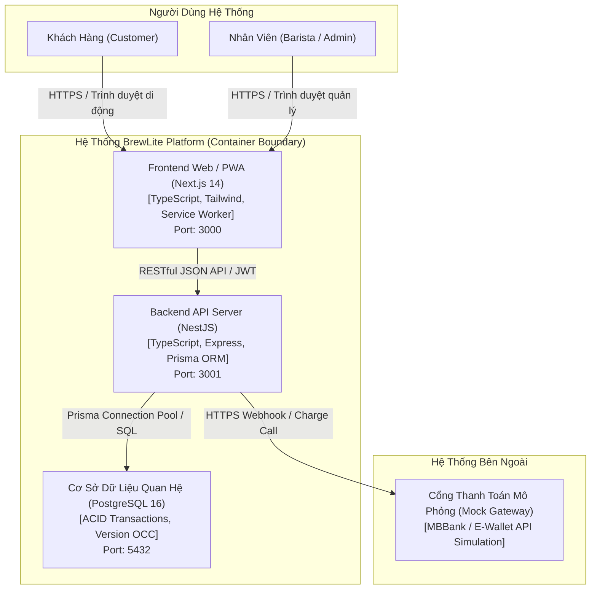

# TÀI LIỆU THIẾT KẾ KIẾN TRÚC HỆ THỐNG (SYSTEM ARCHITECTURE SPECIFICATION)
**Dự án**: Hệ thống Đặt & Quản lý Đồ uống Trực tuyến BrewLite Coffee  
**Môn học**: Công nghệ Phần mềm — Assignment 2  
**Phiên bản**: Ver 1.0  
**Mô hình kiến trúc**: Kiến trúc Phân Tầng (Layered Architecture) & Module-Based Monorepo  

---

## 1. Tổng Quan Kiến Trúc C4 (Level 1: System Context & Level 2: Container)



---

## 2. Chi Tiết Các Tầng Kiến Trúc (Architecture Layers)

### 2.1. Tầng Giao Diện Người Dùng (Frontend Presentation Layer - Next.js 14)
- **Công nghệ**: Next.js 14, React 18, TypeScript, Tailwind CSS, Lucide Icons.
- **Định hướng**: **Mobile-First / PWA (Progressive Web App)**:
  - Khách hàng có thể cài đặt ứng dụng trực tiếp lên màn hình chính điện thoại (Add to Home Screen) mà không cần tải từ kho ứng dụng.
  - Tích hợp `manifest.json` và Service Worker để lưu cache các tài nguyên tĩnh (icons, fonts, stylesheets), hỗ trợ hiển thị ngay lập tức khi mạng chậm.
- **Quản lý trạng thái (State Management)**:
  - Sử dụng React Context và Hooks tùy biến (`useCart`, `useAuth`) kết hợp đồng bộ `localStorage` giúp giỏ hàng và phiên đăng nhập không bị mất khi reload trang.
- **Xử lý UX/UI Defensively**:
  - Đầy đủ trạng thái: Loading skeleton, Empty state khi giỏ hàng trống hoặc hết món, Error Boundary bắt lỗi thân thiện.

### 2.2. Tầng Ứng Dụng & Nghiệp Vụ (Backend Application & Domain Layer - NestJS)
- **Công nghệ**: NestJS Framework, Node.js 20, TypeScript, Class-Validator, Passport JWT.
- **Cấu trúc phân rã theo Domain/Module**:
  - `auth/`: Xác thực tài khoản, băm mật khẩu Bcrypt 10 rounds, phát hành JWT token (Access & Refresh token), phân quyền Role (`CUSTOMER`, `STAFF`, `ADMIN`).
  - `products/`: Quản lý thực đơn, kích cỡ (variants), toppings, tìm kiếm và phân loại đồ uống.
  - `orders/`: Tiếp nhận tạo đơn hàng, quản lý lịch sử đơn của khách, hủy đơn.
  - `payment/`: Xử lý thanh toán an toàn với cơ chế **Idempotency-Key (Task 8)**, tích hợp cổng thanh toán mô phỏng (`mock-gateway`).
  - `staff/`: Quản lý quầy pha chế, tiếp nhận đơn theo **Order State Machine (Task 9)**, xem công thức định lượng nguyên liệu (`recipes`).
  - `admin/`: Thống kê doanh thu, quản lý tồn kho nguyên liệu với **Optimistic Concurrency Control (Task 10.3)**, quản lý tài khoản.
  - `prisma/`: Dịch vụ kết nối cơ sở dữ liệu dùng chung, quản lý vòng đời transaction.

### 2.3. Tầng Dữ Liệu Bền Vững (Persistence Data Layer - PostgreSQL & Prisma)
- **Công nghệ**: PostgreSQL 16 Alpine, Prisma ORM 5.x.
- **Cơ chế Migration**: Toàn bộ thay đổi lược đồ cơ sở dữ liệu được phiên bản hóa và theo dõi thông qua `prisma migrate` và `prisma db push`, đảm bảo tái tạo cấu trúc CSDL 100% tự động trên bất kỳ môi trường nào (Local, CI, Production).
- **Tính toàn vẹn giao dịch (ACID Transactions)**:
  - Sử dụng `prisma.$transaction` để gom nhóm các thao tác: Trừ tiền ➔ Khấu trừ tồn kho nguyên liệu ➔ Cập nhật trạng thái đơn sang `PAID` ➔ Lưu lịch sử thanh toán thành một khối nguyên tử duy nhất. Nếu bất kỳ bước nào thất bại, toàn bộ sẽ được rollback tự động.

---

## 3. Các Cơ Chế & Quyết Định Kỹ Thuật Trọng Tâm

### 3.1. Cơ Chế Idempotency-Key Chống Trừ Tiền 2 Lần (Task 8)
- Mỗi yêu cầu thanh toán từ client phải đính kèm tiêu đề HTTP `x-idempotency-key` (chuỗi UUID ngẫu nhiên duy nhất cho mỗi phiên thanh toán).
- Backend kiểm tra khóa trong bảng `Payment`:
  - **Lần 1 (Chưa tồn tại)**: Tiến hành trừ tiền và trừ kho, lưu `idempotencyKey` vào CSDL với trạng thái `COMPLETED` ➔ Trả về `HTTP 201 Created` (`replayed: false`).
  - **Lần 2 (Trùng lặp do click đúp hoặc mạng retry)**: Backend phát hiện key đã xử lý thành công trước đó ➔ Bỏ qua toàn bộ bước trừ tiền/kho, lập tức trả về kết quả cũ với mã `HTTP 200 OK` (`replayed: true`).

### 3.2. Máy Trạng Thái Đơn Hàng (Order State Machine - Task 9)
- Vòng đời trạng thái của một đơn hàng được mô hình hóa theo đồ thị hữu hạn có hướng nghiêm ngặt:
  $$\text{PENDING} \longrightarrow \text{PAID} \longrightarrow \text{PREPARING} \longrightarrow \text{READY} \longrightarrow \text{COMPLETED}$$
- Hỗ trợ chuyển sang $\text{CANCELLED}$ khi đơn đang ở trạng thái $\text{PENDING}$ hoặc $\text{PAYMENT\_FAILED}$.
- **Quy tắc bảo vệ**: Bất kỳ hành vi nhảy cóc nào (ví dụ từ `PENDING` nhảy thẳng sang `COMPLETED`) đều bị hệ thống ném ngoại lệ `ConflictException` với mã phản hồi `HTTP 409 Conflict`.

### 3.3. Khóa Lạc Quan Chống Âm Kho (Optimistic Concurrency Control - Task 10.3)
- Bảng `Ingredient` được bổ sung trường số nguyên `version`.
- Khi cập nhật số lượng tồn kho:
  ```sql
  UPDATE "Ingredient" 
  SET "stockQuantity" = "stockQuantity" - :amount, "version" = "version" + 1 
  WHERE "id" = :id AND "version" = :currentVersion;
  ```
- Nếu 2 khách hàng cùng tranh mua ly cà phê cuối cùng tại một thời điểm: Khách hàng 1 thành công cập nhật `version = 2`; Khách hàng 2 thực hiện sau sẽ bị phát hiện `version` không khớp (hoặc số lượng không đủ) ➔ Giao dịch của Khách 2 bị hủy và hệ thống trả về mã lỗi `HTTP 409 Conflict` thân thiện, ngăn chặn 100% tình trạng âm kho.

### 3.4. Giám Sát, Logging & Health Check
- **Health Check Endpoint**: Cung cấp `GET /api/health` và `GET /health` kiểm tra trạng thái hoạt động của Node.js process, uptime và câu truy vấn ping CSDL (`SELECT 1`).
- **Structured Logging**: Toàn bộ ngoại lệ được lọc qua `AllExceptionsFilter` toàn cục, ghi log có cấu trúc (Timestamp, Path, Method, Client IP, Correlation ID) phục vụ truy vết sự cố.

---

## 4. Đánh Giá Ưu Điểm, Nhược Điểm & Trade-Offs

| Thành phần kiến trúc | Ưu điểm (Pros) | Hạn chế / Trade-offs (Cons) | Giải pháp cân bằng |
|---|---|---|---|
| **Monorepo (Frontend + Backend trong 1 repo)** | Dễ dàng đồng bộ phiên bản giữa FE/BE, dùng chung tài liệu, quản lý 1 pipeline CI/CD duy nhất. | Repository có dung lượng lớn hơn theo thời gian, cần phân tách dependencies rõ ràng. | Sử dụng thư mục độc lập `frontend/` và `backend/`, cài đặt script npm root điều phối linh hoạt. |
| **Next.js PWA Mobile-First** | Khách hàng không cần cài đặt qua App Store, tải nhanh, giao diện thân thiện trên di động, tiết kiệm chi phí phát triển native. | Không truy cập được sâu vào phần cứng đặc thù như Bluetooth của máy in POS đời cũ. | Đáp ứng hoàn hảo 100% mục tiêu của đề tài đồ án môn học và trải nghiệm người dùng thực tế. |
| **PostgreSQL + Prisma ORM** | Đảm bảo tính toàn vẹn ACID, type-safety mạnh mẽ giữa TypeScript và CSDL, hỗ trợ migration tự động. | Prisma có overhead nhỏ so với Raw SQL trong các câu truy vấn siêu phức tạp hàng triệu bản ghi. | Hoàn toàn tối ưu cho quy mô chuỗi cửa hàng cà phê (vài chục nghìn request/ngày), thời gian phản hồi ≤ 20ms. |
| **Optimistic Locking (OCC)** | Không khóa cứng bảng CSDL (non-blocking), thông lượng (throughput) cao khi số lượng đơn song song lớn. | Giao dịch đến sau bị thất bại cần cơ chế thông báo rõ ràng cho người dùng. | Trả về mã lỗi HTTP 409 rõ ràng kèm thông điệp hướng dẫn khách chọn món khác. |

