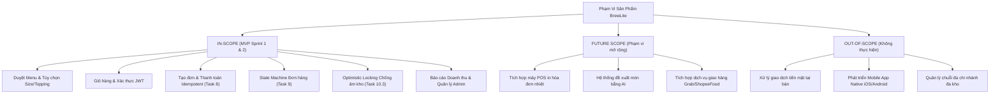

# TÀI LIỆU BỐI CẢNH, STAKEHOLDER VÀ PHẠM VI DỰ ÁN (CONTEXT & SCOPE)
**Dự án**: Hệ thống Đặt & Quản lý Đồ uống Trực tuyến BrewLite Coffee  
**Môn học**: Công nghệ Phần mềm — Assignment 2 (Requirements to Deployment)  
**Phiên bản**: Ver 1.0  
**Ngày lập**: Tháng 11/2026  

---

## 1. Bối Cảnh Nghiệp Vụ & Vấn Đề Cần Giải Quyết

Chuỗi cửa hàng cà phê hiện đại **BrewLite Coffee** phục vụ hàng ngàn lượt khách mỗi ngày với các sản phẩm đồ uống đa dạng (Cà phê Robusta/Arabica, Trà trái cây, Freeze, Topping). Tuy nhiên, mô hình vận hành quầy truyền thống đang đối mặt với các vấn đề nghiêm trọng:

1. **Nghẽn cổ chai tại quầy thu ngân (Bottleneck)**: Vào khung giờ cao điểm (7h30 - 9h00 sáng và 12h00 - 13h30 trưa), khách hàng phải xếp hàng dài chờ gọi món và thanh toán, gây thất thoát doanh thu do khách bỏ về.
2. **Sai sót đơn hàng & Định lượng nguyên liệu**: Nhân viên ghi nhận món thủ công dễ nhầm lẫn kích cỡ (Size S/M/L) hoặc tùy chọn topping/đường/đá. Đồng thời, việc trừ kho nguyên liệu không đồng bộ dẫn đến tình trạng hết nguyên liệu pha chế nhưng hệ thống vẫn nhận đơn (bán âm kho).
3. **Thanh toán trùng lặp khi mạng chập chờn**: Khách hàng thanh toán qua ngân hàng/ví điện tử hoặc ứng dụng trên điện thoại di động gặp hiện tượng "lag" mạng, bấm nút thanh toán nhiều lần dẫn đến việc tài khoản bị trừ tiền 2 lần (Race condition / Double-charging).
4. **Thiếu tính linh hoạt & Khả năng truy cập đa nền tảng**: Khách hàng không muốn cài đặt các ứng dụng native cồng kềnh (dung lượng lớn từ App Store / Google Play) chỉ để đặt 1 ly cà phê tại bàn.

**Giải pháp**: Phát triển nền tảng **BrewLite** theo mô hình **PWA (Progressive Web App) Mobile-First**, kết hợp Backend chuyên biệt xử lý giao dịch an toàn (ACID Transaction, Idempotent Payment, Optimistic Concurrency Control) giúp khách hàng tự quét mã QR tại bàn gọi món, thanh toán tức thì và theo dõi tiến độ pha chế theo thời gian thực.

---

## 2. Bảng Phân Tích Các Stakeholder Chính

| STT | Stakeholder | Vai trò & Trách nhiệm | Mục tiêu & Kỳ vọng chính |
|:---:|---|---|---|
| **1** | **Khách hàng (Customer)** | Người trực tiếp duyệt thực đơn, đặt món và thanh toán tại bàn hoặc mang đi. | • Xem menu trực quan, lọc nhanh đồ uống theo danh mục. • Tự chọn kích cỡ (S/M/L), topping linh hoạt. • Thanh toán an toàn, không bị trừ tiền trùng. • Theo dõi trạng thái đơn hàng (Đang pha chế ➔ Sẵn sàng nhận). |
| **2** | **Nhân viên quầy / Pha chế (Barista / Staff)** | Tiếp nhận đơn hàng, xem công thức pha chế, thực hiện đơn và bàn giao đồ uống cho khách. | • Nhận thông báo đơn hàng mới ngay khi khách thanh toán thành công. • Xem công thức định lượng nguyên liệu chính xác theo từng kích cỡ. • Cập nhật trạng thái đơn (PAID ➔ PREPARING ➔ READY ➔ COMPLETED) nhanh chóng, không bị nhảy cóc lỗi. |
| **3** | **Quản lý cửa hàng (Store Manager / Admin)** | Giám sát doanh thu, quản lý danh mục sản phẩm, theo dõi tồn kho nguyên liệu và tài khoản. | • Xem báo cáo tổng quan: Doanh thu theo ngày, số lượng đơn, top sản phẩm bán chạy. • Kiểm soát kho nguyên liệu chính xác, nhận cảnh báo khi nguyên liệu sắp hết. • Quản lý danh sách nhân viên và tài khoản khách hàng. |
| **4** | **Giảng viên / Khách hàng nghiệm thu** | Đánh giá kiến trúc, chất lượng phần mềm, quy trình triển khai và tính toàn vẹn của mã nguồn. | • Toàn bộ tạo phẩm tài liệu (SRS, Diagram, ADR, Traceability Matrix) đồng nhất 100% với mã nguồn. • Đầy đủ kiểm thử tự động (Unit Test, Integration, Postman, E2E). • Hệ thống triển khai thực tế trên môi trường có thể truy cập được (Production URL HTTPS). |
| **5** | **Nhóm phát triển (Development Team)** | Thiết kế kiến trúc, hiện thực hóa mã nguồn (FE/BE), xây dựng pipeline CI/CD và vận hành. | • Kiến trúc monorepo tinh gọn, chuẩn modular, dễ bảo trì. • Tự động hóa kiểm thử và kiểm soát chất lượng qua GitHub Actions. • Tuân thủ nghiêm ngặt quy ước Git (Conventional Commits, Branching Strategy). |
| **6** | **Đơn vị thanh toán (Payment Provider / Mock Gateway)** | Xử lý giao dịch tài chính, cung cấp cổng thanh toán trực tuyến (Mô phỏng MBBank / Ví). | • Đảm bảo cơ chế Idempotency-Key chống thanh toán trùng lặp khi có sự cố mạng. • Webhook / Callbacks thông báo kết quả giao dịch chính xác, bảo mật. |

---

## 3. Bảng Phạm Vi Sản Phẩm (Scope Matrix)

### 3.1. Trong phạm vi (In-Scope — MVP Sprint 1 & Sprint 2)
- **Sprint 1 (Nền tảng & Menu)**:
  - Repository monorepo, quy chuẩn Git, CI cơ bản (Lint, Test, Build).
  - API sản phẩm (`GET /api/products`, `GET /api/products/:id`, `GET /api/products/toppings`).
  - Giao diện thực đơn Mobile-First bằng Next.js (hỗ trợ loading, empty state, error handling).
  - Seed dữ liệu chuẩn đồ uống và kho nguyên liệu ban đầu trên PostgreSQL.
- **Sprint 2 (Hoàn thiện nghiệp vụ End-to-End & Deployment)**:
  - Xác thực người dùng (Đăng ký, Đăng nhập, JWT Access/Refresh Token, phân quyền Role: `CUSTOMER`, `STAFF`, `ADMIN`).
  - Giỏ hàng động, tính tổng tiền kèm mã giảm giá / khuyến mãi (`POST /api/promotions/validate`).
  - Đặt hàng & Thanh toán mô phỏng đảm bảo **Idempotency** (Task 8 — xử lý an toàn khi gửi trùng key).
  - Quản lý vòng đời trạng thái đơn hàng theo **State Machine** (Task 9: `PENDING` ➔ `PAID` ➔ `PREPARING` ➔ `READY` ➔ `COMPLETED` / `CANCELLED`), chặn đứng nhảy cóc với `HTTP 409 Conflict`.
  - Kiểm soát trừ kho nguyên liệu bằng **Optimistic Locking** (Task 10.3 — chống bán âm kho khi nhiều khách cùng mua).
  - Màn hình Barista xem công thức pha chế định lượng nguyên liệu và nhận/hoàn thành đơn.
  - Dashboard Admin: Thống kê doanh thu, tỷ trọng đơn, quản lý tài khoản và tồn kho.
  - Pipeline CD tự động đóng gói Docker, chạy migration và triển khai lên môi trường Production.

### 3.2. Phạm vi mở rộng (Future Scope)
- Tích hợp cổng thanh toán trực tiếp của đối tác ngân hàng thật (VietQR, MBBank OpenAPI).
- Đẩy thông báo tức thời (Push Notification) qua Web Push / Service Worker khi đồ uống đã pha chế xong.
- Tích hợp máy in hóa đơn nhiệt kết nối Bluetooth/LAN tại quầy Barista.

### 3.3. Ngoài phạm vi (Out-of-Scope)
- **Không** xây dựng ứng dụng Native Mobile (Swift/Kotlin) để đưa lên Google Play / App Store; dự án tập trung tối ưu PWA trên trình duyệt di động.
- **Không** quản lý chuỗi nhượng quyền đa chi nhánh (Multi-tenant/Multi-store); chỉ tập trung cho 1 cửa hàng chuẩn.
- **Không** hỗ trợ thanh toán tiền mặt truyền thống không có xác nhận trên hệ thống.

---

## 4. Giả Định, Ràng Buộc & Rủi Ro Ban Đầu

### 4.1. Giả định (Assumptions)
- Khách hàng sử dụng smartphone có kết nối Internet (4G/Wifi) và trình duyệt web hiện đại hỗ trợ ECMAScript 6+ (Chrome, Safari, Edge).
- Nhân viên quầy và Quản lý được trang bị máy tính bảng hoặc laptop kết nối mạng nội bộ cửa hàng.
- Tỷ giá thanh toán tính theo Việt Nam Đồng (VND), không hỗ trợ đa tiền tệ trong phiên bản này.

### 4.2. Ràng buộc kỹ thuật & quy chuẩn (Constraints)
- **Frontend**: Bắt buộc sử dụng **Next.js** (App Router / Pages), thiết kế giao diện Mobile-First/PWA với Tailwind CSS.
- **Backend**: Bắt buộc sử dụng **NestJS** theo kiến trúc Modular / Domain-Driven, áp dụng Dependency Injection.
- **Cơ sở dữ liệu**: Bắt buộc sử dụng **PostgreSQL**, quản lý schema và migration qua **Prisma ORM**.
- **Container hóa**: Bắt buộc có `docker-compose.yml` để khởi chạy đầy đủ Database, API và Frontend ở môi trường local.
- **Kiến trúc dữ liệu**: Toàn bộ dữ liệu mật khẩu phải được băm bảo mật bằng **Bcrypt với Salt Rounds = 10**.

### 4.3. Rủi ro ban đầu & Biện pháp giảm thiểu (Risks & Mitigations)

| Mã | Rủi ro nhận diện | Mức độ | Biện pháp giảm thiểu (Mitigation Strategy) |
|:---:|---|:---:|---|
| **R-01** | Tranh chấp tồn kho khi 2 khách hàng cùng đặt ly cà phê cuối cùng tại một thời điểm. | **Cao** | Áp dụng cơ chế **Optimistic Concurrency Control (OCC)** với trường `version` trong bảng `Ingredient`. Giao dịch đến sau bị xung đột version sẽ rollback và trả mã `HTTP 409 Conflict`. |
| **R-02** | Khách hàng nhấp liên tục nút thanh toán do mạng chậm, gây trừ tiền 2 lần. | **Cao** | Triển khai cơ chế **Idempotency-Key** (Task 8) ở tầng Backend Cache/Database. Request thứ 2 cùng key sẽ lập tức trả kết quả cũ mà không tạo thêm giao dịch thanh toán mới. |
| **R-03** | Sai lệch trạng thái đơn hàng (nhân viên ấn nhầm nút Hoàn thành khi đơn chưa thanh toán). | **Trung bình** | Xây dựng **Order State Machine** nghiêm ngặt. Kiểm tra logic hợp lệ trước khi chuyển trạng thái; chặn đứng mọi hành vi nhảy cóc bằng mã lỗi `HTTP 409 Conflict`. |
| **R-04** | Lỗi build hoặc test thất bại khi tích hợp mã nguồn của nhiều thành viên. | **Trung bình** | Thiết lập pipeline GitHub Actions CI bắt buộc: Chặn merge PR nếu Lint, Unit Test hoặc Build thất bại. |
