# ĐẶC TẢ YÊU CẦU PHẦN MỀM RÚT GỌN (SOFTWARE REQUIREMENTS SPECIFICATION - SRS)
**Dự án**: Hệ thống Đặt & Quản lý Đồ uống Trực tuyến BrewLite Coffee  
**Môn học**: Công nghệ Phần mềm — Assignment 2  
**Phiên bản**: Ver 1.0  
**Chuẩn phân loại**: MoSCoW (Must, Should, Could, Won't)  

---

## 1. Sơ Đồ Use-Case Tổng Quát Toàn Hệ Thống

Toàn bộ hệ thống BrewLite gồm **32 Use-Case (UC-01 đến UC-32)** phân bổ trên 4 nhóm tác nhân chính (`Customer`, `Barista`, `Admin`, `Payment Gateway`) và tác nhân trừu tượng `User` («Abstract»), được chi tiết hóa trong file [01-usecase-overall.drawio](file:///C:/Users/Lenovo/Desktop/tong%20hop/Assigment2/docs/diagrams/usecases/01-usecase-overall.drawio) và ảnh [Usecase_cnpm_01.drawio.png](file:///C:/Users/Lenovo/Desktop/tong%20hop/Assigment2/docs/report/img/Usecase_cnpm_01.drawio.png):

```mermaid
graph TD
    subgraph Actors["Tác Nhân Hệ Thống (Actors)"]
        User["«Abstract» Người Dùng Chung (User)"]
        Customer["Khách Hàng (Customer)"]
        Barista["Nhân Viên Pha Chế (Barista)"]
        Admin["Quản Trị Viên (Admin)"]
        PaymentGW["«System» Cổng Thanh Toán"]
    end

    Customer -.->|kế thừa| User
    Barista -.->|kế thừa| User
    Admin -.->|kế thừa| User

    subgraph P1["Phân Hệ 1: Tài Khoản & Thực Đơn"]
        UC01["UC-01: Đăng ký tài khoản"]
        UC02["UC-02: Đăng nhập"]
        UC03["UC-03: Đổi mật khẩu"]
        UC04["UC-04: Thông tin cá nhân"]
        UC05["UC-05: Làm mới phiên JWT"]
        UC06["UC-06: Đăng xuất"]
        UC07["UC-07: Xem & Tìm thực đơn"]
        UC08["UC-08: Chi tiết món, Size & Topping"]
        UC09["UC-09: Quản lý giỏ hàng"]
    end

    subgraph P2["Phân Hệ 2: Đặt Hàng & Thanh Toán"]
        UC10["UC-10: Tra cứu voucher khả dụng"]
        UC11["UC-11: Áp dụng Voucher & Điểm thưởng"]
        UC12["UC-12: Khởi tạo đơn hàng (PENDING)"]
        UC13["UC-13: Thanh toán đơn hàng (PAID)"]
        UC14["UC-14: Đồng bộ MBBank VietQR"]
        UC15["UC-15: Khấu trừ kho OCC"]
        UC16["UC-16: Tự động tích lũy Loyalty"]
    end

    subgraph P3["Phân Hệ 3: Theo Dõi, Hủy & Đánh Giá"]
        UC17["UC-17: Theo dõi tiến trình đơn"]
        UC18["UC-18: Hủy đơn hoàn kho tự động"]
        UC19["UC-19: Xem lịch sử đơn hàng"]
        UC20["UC-20: Gửi đánh giá món đã mua"]
        UC21["UC-21: Chỉnh sửa / Xóa đánh giá"]
    end

    subgraph P4["Phân Hệ 4: Quầy Pha Chế (Barista)"]
        UC22["UC-22: Tiếp nhận đơn (PAID -> PREPARING)"]
        UC23["UC-23: Pha chế xong (PREPARING -> READY)"]
        UC24["UC-24: Giao đồ uống (READY -> COMPLETED)"]
        UC25["UC-25: Xem Kanban pha chế FIFO"]
        UC26["UC-26: Xem công thức định lượng (Recipes)"]
    end

    subgraph P5["Phân Hệ 5: Quản Trị Hệ Thống (Admin)"]
        UC27["UC-27: Thống kê doanh thu & Báo cáo"]
        UC28["UC-28: Quản lý kho & Nhập hàng"]
        UC29["UC-29: Quản lý sản phẩm & Công thức"]
        UC30["UC-30: Quản lý mã khuyến mãi"]
        UC31["UC-31: Kiểm duyệt đánh giá"]
        UC32["UC-32: Quản lý nhân sự & Khách hàng"]
    end

    User --> UC02
    User --> UC03
    User --> UC04
    User --> UC05
    User --> UC06

    Customer --> UC01
    Customer --> UC07
    Customer --> UC08
    Customer --> UC09
    Customer --> UC10
    Customer --> UC12
    Customer --> UC13
    Customer --> UC17
    Customer --> UC18
    Customer --> UC19
    Customer --> UC20
    Customer --> UC21

    PaymentGW --> UC13
    PaymentGW --> UC14

    Barista --> UC22
    Barista --> UC23
    Barista --> UC24
    Barista --> UC25

    Admin --> UC27
    Admin --> UC28
    Admin --> UC29
    Admin --> UC30
    Admin --> UC31
    Admin --> UC32
```

---

## 2. Bảng Yêu Cầu Chức Năng (Functional Requirements - FR)

| Mã FR | Tên chức năng | Mô tả chi tiết | Mức ưu tiên (MoSCoW) | Tiêu chí chấp nhận (Acceptance Criteria - AC) |
|:---:|---|---|:---:|---|
| **FR-01** | **Duyệt & Tìm kiếm Thực đơn (Menu)** | Hiển thị danh sách đồ uống phân theo danh mục (Cà phê, Trà, Đá xay); hỗ trợ tìm kiếm theo tên và lọc theo danh mục. | **Must** | • API `GET /api/products` trả về status 200 kèm danh sách sản phẩm và các biến thể. • Phản hồi dưới 200ms. • Có trạng thái Loading khi tải và Empty state khi không tìm thấy kết quả. |
| **FR-02** | **Xem Chi tiết & Biến thể sản phẩm** | Xem thông tin chi tiết một món đồ uống, danh sách kích cỡ (Size S/M/L) kèm mức giá tương ứng và các tùy chọn topping. | **Must** | • API `GET /api/products/:id` trả về thông tin món, ảnh, mô tả và bảng giá size. • API `GET /api/products/toppings` trả về đầy đủ các loại topping có sẵn. |
| **FR-03** | **Quản lý Giỏ hàng (Cart)** | Cho phép khách hàng thêm món, tăng/giảm số lượng, chọn size/topping, hỗ trợ gom nhiều ly ($N$ ly) vào các dòng OrderItems, tự động tính tổng tiền tức thời. | **Must** | • Giỏ hàng được lưu trữ persistent (Local Storage) ở client. • Cập nhật tổng tiền tức thời khi thay đổi số lượng hoặc chọn topping. • Gom nhiều ly thành danh sách OrderItems rõ ràng trong cùng một giỏ hàng. |
| **FR-04** | **Xác thực & Phân quyền (Auth)** | Đăng ký tài khoản mới, Đăng nhập hệ thống, cấp phát JWT Access Token và Refresh Token; phân định rõ Role: `CUSTOMER`, `STAFF`, `ADMIN`. | **Must** | • API `POST /api/auth/register` mã hóa mật khẩu bằng Bcrypt 10 rounds. • API `POST /api/auth/login` trả về access token có hạn dùng hợp lý và thông tin user kèm Role. • Chặn truy cập trái phép bằng `JwtAuthGuard` và `RolesGuard` với HTTP 401/403. |
| **FR-05** | **Áp dụng Mã Khuyến Mãi (Voucher) Đa Tầng** | Khách hàng chọn/nhập mã giảm giá tại quán (không áp dụng freeship vì nhận tại quầy); mỗi mã hiển thị rõ điều kiện đơn tối thiểu và mức giảm tối đa; hỗ trợ quy tắc cộng dồn: 1 mã đơn hàng + 1 mã giờ vàng (HAPPYHOUR) + điểm loyalty; khóa chọn khi đơn về 0đ. | **Should** | • API `POST /api/promotions/validate` kiểm tra tính hợp lệ của mã, hạn sử dụng, giá trị đơn tối thiểu. • UI hiển thị điều kiện minh bạch, cảnh báo lý do và số tiền còn thiếu nếu chưa đủ điều kiện. • Chặn chọn thêm mã khi tổng đơn đã giảm về 0đ. |
| **FR-06** | **Tạo Đơn Hàng (Create Order)** | Khách hàng xác nhận giỏ hàng để tạo duy nhất 1 đơn hàng mới ở trạng thái khởi tạo `PENDING` chứa toàn bộ các món trong giỏ hàng (không chia nhỏ thành nhiều đơn). | **Must** | • API `POST /api/orders` tạo đơn hàng thành công (HTTP 201). • Lưu chi tiết toàn bộ các món (`OrderItem`), số lượng, size, topping và tổng tiền vào Database. • Xử lý đúng khi đơn có nhiều chi tiết cùng biến thể sản phẩm nhưng khác topping. |
| **FR-07** | **Thanh Toán Đảm Bảo Idempotency (Task 8)** | Thực hiện thanh toán cho đơn hàng qua Cổng thanh toán mô phỏng kèm theo tiêu đề `Idempotency-Key`. | **Must** | • Request lần 1: Thanh toán thành công, đơn chuyển sang `PAID` (HTTP 201, `replayed: false`). • Request lần 2 (cùng key): Hệ thống phát hiện trùng lặp, trả về kết quả cũ mà không trừ tiền lần 2 (HTTP 200, `replayed: true`). |
| **FR-08** | **Máy Trạng Thái Đơn Hàng (State Machine - Task 9)** | Vòng đời đơn hàng phải chuyển tuần tự theo đúng quy trình nghiệp vụ: `PENDING` ➔ `PAID` ➔ `PREPARING` ➔ `READY` ➔ `COMPLETED`. | **Must** | • Nhân viên quầy nhận đơn: `PAID` ➔ `PREPARING` (API `/staff/orders/:id/accept`). • Pha xong: `PREPARING` ➔ `READY` (API `/staff/orders/:id/ready`). • Giao nước: `READY` ➔ `COMPLETED` (API `/staff/orders/:id/complete`). • **Ngăn chặn chuyển trạng thái sai quy trình**: Mọi hành vi chuyển sai quy tắc (VD: `PENDING` ➔ `COMPLETED`) đều bị từ chối với mã lỗi `HTTP 409 Conflict`. |
| **FR-09** | **Kiểm Soát Tranh Chấp Kho (Optimistic Locking - Task 10.3)** | Trừ kho nguyên liệu khi đơn hàng được thanh toán (`PAID`), sử dụng khóa lạc quan (OCC) để ngăn chặn xuất vượt quá tồn kho thực tế. | **Must** | • Mỗi nguyên liệu (`Ingredient`) có cột `version`. • Khi 2 khách cùng đặt sản phẩm dùng nguyên liệu cuối cùng: Khách 1 thanh toán thành công, Khách 2 bị từ chối với `HTTP 409 Conflict` (Thông báo hết hàng) mà không làm âm kho. |
| **FR-10** | **Xem Lịch Sử & Chi Tiết Đơn Hàng** | Khách hàng xem danh sách các đơn hàng đã đặt (mỗi đơn đại diện cho 1 hóa đơn gồm $N$ ly) và theo dõi tiến độ pha chế của từng đơn theo thời gian thực. | **Must** | • API `GET /api/orders/me` trả về danh sách đơn của chính tài khoản đó kèm số lượng món tổng hợp. • API `GET /api/orders/:id` trả về chi tiết toàn bộ các dòng món (OrderItem) và trạng thái hiện tại. |
| **FR-11** | **Hủy Đơn Hàng & Hoàn Kho Tự Động (Cancel Order)** | Cho phép khách hàng hủy đơn hàng khi đơn ở trạng thái `PENDING` hoặc `PAID` (trước khi Barista nhận pha chế `PREPARING`); tự động hoàn trả nguyên liệu vào kho và hoàn tiền/điểm loyalty nếu đã `PAID`. | **Should** | • API `POST /api/orders/:id/cancel` chuyển trạng thái đơn sang `CANCELLED`. • Tự động kích hoạt compensating transaction cộng trả nguyên liệu (`stockQuantity.increment`) theo công thức. • Chặn hủy khi đơn đã được Barista nhận pha chế (`PREPARING`) để bảo toàn chi phí nguyên liệu đã chế biến. |
| **FR-12** | **Đánh Giá & Nhận Xét Đồ Uống (Reviews)** | Khách hàng viết đánh giá (1-5 sao kèm bình luận) cho các sản phẩm đã mua thành công. | **Could** | • Kiểm tra điều kiện đã từng mua sản phẩm (`KiemTraDaMua`). • Hỗ trợ tạo mới, cập nhật và xóa đánh giá cá nhân. |
| **FR-13** | **Quản Trị Hệ Thống & Báo Cáo (Admin Portal)** | Bảng điều khiển dành cho Quản lý cửa hàng: Xem biểu đồ doanh thu, thống kê top đồ uống bán chạy, quản lý tồn kho nguyên liệu. | **Should** | • API `GET /api/admin/stats/overview` và `GET /api/admin/stats/revenue` trả về số liệu chuẩn xác. • Hỗ trợ nhập và cập nhật kho nguyên liệu (`PATCH /api/admin/ingredients/:id`). |
| **FR-14** | **Ứng Dụng Native Mobile, Đa Chi Nhánh & Tiền Mặt** | Phát triển app Native iOS/Android, quản lý chuỗi đa chi nhánh hoặc thanh toán tiền mặt không xác nhận trên hệ thống. | **Won't** | • Không triển khai trong phạm vi Assignment 2 (đã loại khỏi phạm vi ở `context-and-scope.md` Mục 3.3). |

---

## 3. Bảng Yêu Cầu Phi Chức Năng (Non-Functional Requirements - NFR)

| Mã NFR | Phân nhóm | Mô tả yêu cầu | Mức ưu tiên | Tiêu chí chấp nhận & Đo lường (Verification) |
|:---:|---|---|:---:|---|
| **NFR-01** | **Hiệu Năng (Performance)** | Thời gian phản hồi của các API truy vấn dữ liệu (Menu, Chi tiết món, Lịch sử) phải nhanh chóng, tối ưu hóa trải nghiệm người dùng di động. | **Must** | • 95% số lượng request đọc (Read requests) có thời gian phản hồi ≤ 200ms trong điều kiện mạng thông thường. • Thời gian phản hồi trung bình qua Newman CLI ≤ 50ms. |
| **NFR-02** | **Bảo Mật (Security)** | Đảm bảo tính toàn vẹn dữ liệu, chống tấn công phổ biến (SQL Injection, XSS, CSRF) và bảo vệ thông tin đăng nhập. | **Must** | • Toàn bộ mật khẩu lưu trữ trong CSDL phải được băm bằng thuật toán **Bcrypt với Salt rounds = 10**. • Mọi API nhạy cảm phải yêu cầu JWT Bearer Token hợp lệ. • Phân quyền chặt chẽ giữa khách hàng và nhân viên quầy. |
| **NFR-03** | **Tính Khả Dụng & Trải Nghiệm (Usability & PWA)** | Ứng dụng Frontend thiết kế theo định hướng Mobile-First, giao diện thích ứng mượt mà trên màn hình di động (Responsive). | **Must** | • Đạt điểm Google Lighthouse Accessibility ≥ 90. • Cung cấp đầy đủ trạng thái tương tác: Loading spinner, Empty state thông báo rõ ràng, Error boundary bắt lỗi thân thiện. |
| **NFR-04** | **Toàn Vẹn Dữ Liệu & Giao Dịch (Data Integrity)** | Các thao tác tạo đơn, trừ tiền và trừ kho nguyên liệu phải đảm bảo tính chất **ACID Transaction**. | **Must** | • Sử dụng Prisma Interactive Transaction (`prisma.$transaction`). • Không bao giờ để xảy ra tình trạng: Tiền đã trừ nhưng kho không cập nhật, hoặc kho bị trừ âm. |
| **NFR-05** | **Khả Năng Triển Khai (Deployability & DevOps)** | Toàn bộ mã nguồn phải có khả năng đóng gói bằng Docker và triển khai tự động qua quy trình CI/CD. | **Must** | • Có `docker-compose.yml` khởi chạy đồng thời Web, API và Database ở local bằng 1 lệnh duy nhất. • Pipeline GitHub Actions tự động kiểm tra Lint, Test và Build trên mỗi Pull Request. |
| **NFR-06** | **Giám Sát & Sức Khỏe Hệ Thống (Observability)** | Hệ thống phải có cơ chế kiểm tra tình trạng sống (Liveness/Readiness) phục vụ giám sát container và tự động phục hồi. | **Must** | • Cung cấp endpoint `GET /api/health` và `GET /health` trả về trạng thái hoạt động của server và kết nối CSDL (HTTP 200 OK). |

