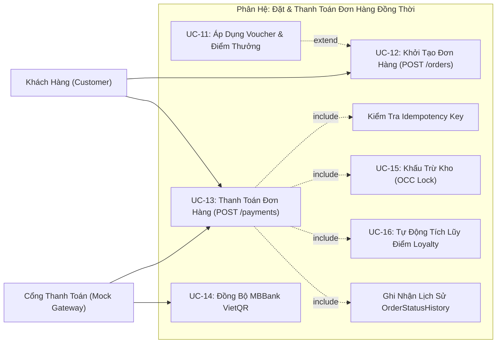

# ĐẶC TẢ USE-CASE TRỌNG TÂM: ĐẶT VÀ THANH TOÁN ĐƠN HÀNG (UC-12 & UC-13)
**Dự án**: Hệ thống Đặt & Quản lý Đồ uống Trực tuyến BrewLite Coffee  
**Môn học**: Công nghệ Phần mềm — Assignment 2  
**Mã Use-case**: UC-12 (Khởi tạo đơn hàng PENDING) & UC-13 (Thanh toán đơn hàng PAID Idempotent)  
**Phiên bản**: Ver 1.0  

---

## 1. Sơ Đồ Use-Case (Use-Case Diagram)

Sơ đồ Use-case phạm vi đặt hàng & thanh toán được lưu tại [03-subsystem-order-payment.drawio](../diagrams/usecases/03-subsystem-order-payment.drawio) và ảnh [Usecase_cnpm_03.drawio.png](../report/img/Usecase_cnpm_03.drawio.png):

---

## 2. Thông Tin Chung Của Use-Case

| Thuộc tính | Chi tiết mô tả |
|---|---|
| **Tên Use-case** | Đặt Hàng (UC-12) và Thanh Toán Trực Tuyến Đảm Bảo Idempotency (UC-13) |
| **Mã định danh** | **UC-12 & UC-13** (tương ứng Hình 1.2 trong báo cáo kiến trúc) |
| **Actor chính** | Khách hàng đã đăng nhập (`Customer`) |
| **Actor phụ** | Cổng thanh toán mô phỏng (`Mock Payment Gateway`), Nhân viên quầy (`Barista`) |
| **Trigger (Kích hoạt)** | Khách hàng bấm nút **"Xác nhận thanh toán"** trên màn hình Giỏ hàng / Thanh toán của giao diện Next.js PWA. |
| **Liên kết yêu cầu (Traceability)** | **FR-03** (Giỏ hàng), **FR-04** (Xác thực JWT), **FR-06** (Tạo đơn hàng), **FR-07** (Thanh toán Idempotent), **FR-08** (Order State Machine), **FR-09** (Trừ kho OCC), **NFR-02** (Bảo mật), **NFR-04** (Tính toàn vẹn ACID). |

---

## 3. Điều Kiện Tiền Đề & Hậu Điều Kiện

### 3.1. Tiền điều kiện (Preconditions)
1. Khách hàng đã đăng nhập vào hệ thống và sở hữu JWT Token hợp lệ.
2. Giỏ hàng có ít nhất một món đồ uống với số lượng ≥ 1.
3. Mỗi sản phẩm trong giỏ hàng phải có ít nhất một biến thể size hợp lệ và còn nguyên liệu khả dụng trong kho.

### 3.2. Hậu điều kiện (Postconditions)
- **Nếu thành công**:
  - Đơn hàng được tạo và chuyển trạng thái từ `PENDING` sang `PAID`.
  - Kho nguyên liệu được khấu trừ tương ứng với định lượng công thức pha chế của từng món (Robusta, Arabica, Sữa, Syrup...).
  - Bản ghi thanh toán (`Payment`) được lưu trữ kèm mã `idempotencyKey` và thời gian giao dịch.
  - Đơn hàng xuất hiện trên màn hình chờ pha chế của Barista (`/staff/orders`).
  - Giỏ hàng của khách hàng trên client được làm trống.
- **Nếu thất bại**:
  - Đơn hàng giữ nguyên trạng thái `PENDING` hoặc chuyển sang `PAYMENT_FAILED`.
  - Kho nguyên liệu **hoàn toàn không bị trừ** (Rollback giao dịch CSDL).
  - Khách hàng nhận được thông báo lỗi cụ thể (ví dụ: "Nguyên liệu pha chế đã hết", "Số dư ví không đủ").

---

## 4. Các Luồng Nghiệp Vụ (Flow of Events)

### 4.1. Luồng chính (Main Flow / Happy Path)
1. **Bước 1**: Khách hàng kiểm tra lại các món trong giỏ hàng (Size, Topping, Số lượng) và bấm **"Thanh toán ngay"**.
2. **Bước 2**: Client Frontend Next.js tự động tạo một khóa ngẫu nhiên duy nhất `idempotencyKey` (chuẩn UUID v4).
3. **Bước 3**: Client gửi request `POST /api/orders` kèm theo Bearer JWT Token để khởi tạo đơn hàng mới.
4. **Bước 4**: Backend NestJS xác thực JWT, tính toán tổng tiền, tạo bản ghi `Order` với trạng thái `PENDING` và trả về `orderId`.
5. **Bước 5**: Client gửi tiếp request thanh toán `POST /api/payments` chứa `orderId`, phương thức thanh toán (`BANK_TRANSFER` / `WALLET`) và header `Idempotency-Key: <idempotencyKey>`.
6. **Bước 6**: Backend kiểm tra `idempotencyKey` trong bảng `Payment`:
   - Không tìm thấy khóa trùng ➔ Xác định đây là giao dịch mới (First Execution).
7. **Bước 7**: Backend mở một Interactive Database Transaction (`prisma.$transaction`):
   - Đọc tồn kho các nguyên liệu cần cho đơn hàng.
   - Kiểm tra điều kiện tồn kho ≥ số lượng định lượng yêu cầu.
   - Cập nhật số lượng tồn kho mới và tăng cột `version` lên 1 (Optimistic Locking).
   - Chuyển trạng thái đơn hàng từ `PENDING` ➔ `PAID`.
   - Tạo bản ghi `Payment` với `status: COMPLETED` và `idempotencyKey`.
8. **Bước 8**: Backend commit transaction thành công, trả về phản hồi `HTTP 201 Created` kèm `replayed: false`.
9. **Bước 9**: Giao diện hiển thị màn hình chúc mừng "Thanh toán thành công!", xóa giỏ hàng và chuyển hướng khách hàng sang trang **Theo dõi đơn hàng** (`/orders/:id`).

---

### 4.2. Luồng thay thế (Alternative Flows)

#### A1: Khách hàng áp dụng mã giảm giá (Voucher) và Điểm thưởng đa tầng
- Tại Bước 1, khách hàng xem danh sách voucher tại quán (không có freeship vì mô hình BrewLite là nhận tại quầy/mang đi).
- Mỗi mã hiển thị rõ điều kiện: Đơn tối thiểu, mức giảm tối đa, khung giờ vàng.
- Nếu đơn chưa đủ điều kiện, giao diện làm mờ và báo rõ số tiền còn thiếu.
- Khách hàng có thể chọn nhiều voucher theo quy tắc: tối đa 1 mã Giảm giá đơn hàng + 1 mã Giờ vàng (HAPPYHOUR) + Điểm thưởng Loyalty tích lũy.
- Client gọi API `POST /api/promotions/validate` (hoặc tính toán tức thời), tự động khóa chọn thêm mã khi tổng đơn đã giảm về 0đ.
- Hệ thống trừ tiền giảm giá vào tổng tiền thanh toán trước khi sang Bước 3.

#### A2: Khách hàng nhấn đúp nút thanh toán hoặc gửi lại yêu cầu khi mạng không ổn định (Idempotency Replay)
- Tại Bước 5, do kết nối mạng không ổn định, khách hàng nhấn thanh toán lần 2 (hoặc client tự động retry) với cùng mã `idempotencyKey`.
- Backend kiểm tra thấy `idempotencyKey` này **đã tồn tại** trong cơ sở dữ liệu và đã thanh toán thành công trước đó.
- Backend **bỏ qua** toàn bộ bước trừ tiền và trừ kho, lập tức trả về kết quả của giao dịch trước đó với mã `HTTP 200 OK` kèm cờ `replayed: true`.
- Khách hàng không bị trừ tiền thêm lần nào, giao diện hiển thị thông báo "Đơn hàng của bạn đã được ghi nhận trước đó".

#### A3: Khách hàng hủy đơn hàng (Cancel Order & Hoàn kho tự động)
- Khách hàng gửi yêu cầu hủy đơn qua API `POST /api/orders/:id/cancel`.
- Nếu đơn ở trạng thái `PENDING`: Đơn lập tức chuyển sang `CANCELLED`.
- Nếu đơn ở trạng thái `PAID` (trước khi Barista nhận đơn `PREPARING`): Backend kích hoạt giao dịch bù (Compensating Transaction) tự động hoàn trả số lượng tồn kho nguyên liệu (`stockQuantity.increment`) theo công thức, hoàn tiền ví điện tử và thu hồi điểm thưởng loyalty.
- Nếu đơn đã sang `PREPARING`: Yêu cầu hủy bị từ chối (HTTP 400/409) do nguyên liệu đã đưa vào pha chế thực tế.

---

### 4.3. Luồng ngoại lệ (Exception Flows)

#### E1: Khách hàng chưa đăng nhập hoặc Token hết hạn
- Tại Bước 3 hoặc Bước 5, Backend phát hiện token không hợp lệ hoặc đã hết hạn.
- Backend trả về mã lỗi `HTTP 401 Unauthorized`.
- Client hiển thị thông báo "Phiên đăng nhập đã hết hạn" và tự động điều hướng khách hàng về màn hình Đăng nhập.

#### E2: Xung đột tồn kho khi nhiều khách hàng cùng thanh toán nguyên liệu sắp hết (Optimistic Lock Conflict)
- Tại Bước 7, khách hàng A và khách hàng B cùng thanh toán đơn hàng sử dụng phần nguyên liệu cuối cùng.
- Khách hàng A giao dịch thành công trước, số lượng nguyên liệu trong kho giảm về 0 và `version` tăng lên.
- Giao dịch của khách hàng B phát hiện số lượng tồn kho không đủ (hoặc `version` đã thay đổi).
- Backend kích hoạt Rollback toàn bộ transaction, hủy trạng thái thanh toán và trả về mã lỗi `HTTP 409 Conflict` kèm thông điệp: *"Nguyên liệu Cà phê hạt Robusta không đủ để thực hiện món này"*.
- Client hiển thị cảnh báo đỏ thân thiện: *"Rất tiếc! Món này vừa hết nguyên liệu pha chế. Vui lòng chọn món khác"*.

#### E3: Cố tình chuyển đổi trạng thái đơn hàng trái phép (State Machine Violation)
- Nếu client hoặc người dùng can thiệp gửi request thanh toán cho một đơn hàng đã bị hủy (`CANCELLED`) hoặc đã hoàn thành (`COMPLETED`).
- Backend kiểm tra bộ quy tắc State Machine: Trạng thái hiện tại không cho phép chuyển sang `PAID`.
- Hệ thống từ chối yêu cầu và phản hồi `HTTP 409 Conflict` với thông điệp: *"Không thể chuyển trạng thái từ CANCELLED sang PAID"*.

