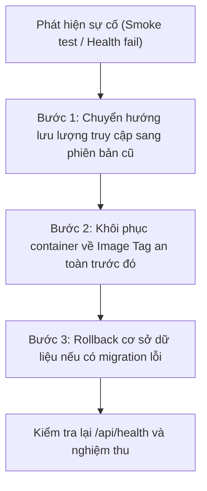

# HƯỚNG DẪN QUY TRÌNH ROLLBACK HỆ THỐNG KHI GẶP SỰ CỐ
**Dự án**: Hệ thống Đặt & Quản lý Đồ uống Trực tuyến BrewLite Coffee  
**Môn học**: Công nghệ Phần mềm — Assignment 2 (Task 5.3 & Task 5.4)  
**Phiên bản**: Ver 1.0  

---

## 1. Khi Nào Cần Kích Hoạt Rollback?

Quy trình Rollback được kích hoạt ngay lập tức khi xảy ra một trong các tình huống sau:
1. **Health Check thất bại**: Endpoint `GET /api/health` trả về mã lỗi khác `200 OK` (ví dụ: `500 Internal Server Error` hoặc `database: disconnected`) sau khi deploy phiên bản mới.
2. **Smoke Test thất bại**: Các API nghiệp vụ trọng yếu (Đăng nhập, Xem menu, Tạo đơn) trả về lỗi không mong muốn hoặc crash process.
3. **Lỗi nghiêm trọng sau triển khai**: Khách hàng không thể thanh toán hoặc lỗi tính sai tổng tiền.

---

## 2. Quy Trình Rollback Chi Tiết (3 Bước)



### Bước 1: Khôi phục Container / Application về phiên bản trước (Revert Git / Docker Tag)
1. Xác định mã commit SHA hoặc Tag ổn định trước đó (ví dụ: `v1.0.0` hoặc commit `9546996`).
2. Kéo (Pull) hoặc chuyển đổi sang image an toàn:
   ```bash
   git checkout <PREVIOUS_STABLE_COMMIT_OR_TAG>
   npm run build
   npm run start
   ```
3. Hoặc nếu sử dụng Docker Compose:
   ```bash
   docker compose down
   docker compose up -d --build
   ```

### Bước 2: Xử lý Rollback Cơ sở dữ liệu (Database Schema Migration)
- Nếu bản deploy mới có chứa migration CSDL gây lỗi:
  ```bash
  cd backend
  # Xem trạng thái migration
  npx prisma migrate status
  
  # Khôi phục CSDL về trạng thái chuẩn
  npx prisma db push --force-reset
  npm run seed
  ```

### Bước 3: Kiểm tra Xác nhận Phục hồi (Post-Rollback Verification)
1. Kiểm tra lại tình trạng sống của API:
   ```bash
   curl -i http://localhost:3001/api/health
   # Bắt buộc trả về HTTP 200 { status: 'ok', database: 'connected' }
   ```
2. Chạy nhanh kịch bản kiểm thử tự động để đảm bảo toàn bộ nghiệp vụ hoạt động lại bình thường:
   ```bash
   npm run test
   ```
